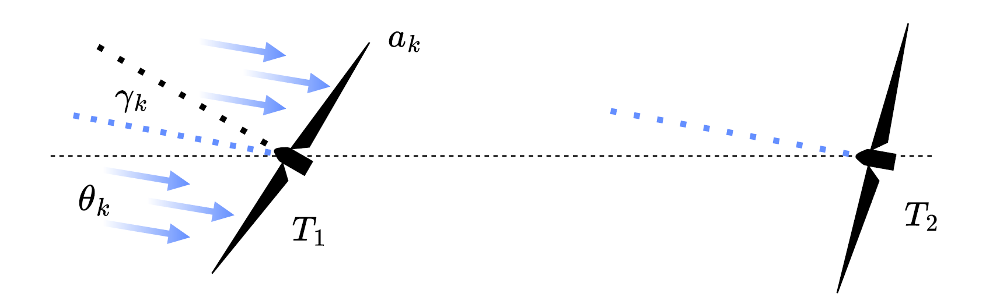

# Stepsize selection for time-varying online feedback optimization using spectral information

## Authors

Fritz A. Engeln\*, Marta Zagórowska\*, Lukas Ortmann\* , Jan-Willem van Wingerden\*

\* Delft Center for Systems and Control, Delft University of Technology, Delft, The Netherlands

Corresponding author: Fritz A. Engeln
Email: f.a.engeln@tudelft.nl
## Abstract

Time-varying convex optimization problems commonly arise in feedback optimization controllers, where changes in system dynamics, operating conditions, or external disturbances can cause the minimizer to evolve over time. We analyze the tracking performance of a scaled gradient algorithm using contraction theory and derive a stepsize that minimizes an upper bound on the tracking error. We then extend the analysis to exploit knowledge of the Fourier spectrum of the time-varying minimizer to determine a stepsize that further reduces the tracking error. The proposed results are demonstrated on a wind farm feedback optimization problem, where the frequency of the minimizer is inferred from changes in wind direction. Numerical results show that incorporating spectral information into stepsize selection improves tracking performance compared with a stepsize designed without prior spectral information.

## Overview

This repository contains the code accompanying the paper:

**"Stepsize selection for time-varying online feedback optimization using spectral information"**

The repository provides all scripts required to reproduce the numerical example presented in the paper.

  

## Reproducing the Results

1. Run ...
2. Execute ...
3. Run ...

<!--
## Citation

If you use this code in your research, please cite:

F. A. Engeln, M. Zagórowska, and J.-W. van Wingerden, *Time-varying feedback optimization: Convergence bounds and stepsize selection*
--!>
